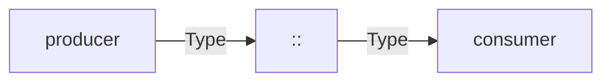

# <MODULE> — architecture

<!--
TEMPLATE (R-REQ-17). An `architecture` supporting document. Copy, rename to
<MODULE>_Architecture.md, declare it under `context:` in layers.yaml, and cite
it from at least one requirement document.

Same three rules as concept_document.md: no UIDs allocated (C-CONTEXT-UID),
cited by the set (C-CONTEXT-UNREF), no execution narration -- THE TEST IS TENSE.
A design row says what WILL be true of the code; narration says what happened.

WHERE THIS ENDS AND `IMP` BEGINS. This document says what the structure IS and
why it is that shape. The `IMP` layer -- if the set declares one -- says which
file, which symbol, in what order, one row per software requirement, and a path
there is a promise that the code goes at that path under that name. If the set
declares IMP, keep the file-by-file table THERE and keep this document to the
shape and its reasons; if it does not, this document is where the decomposition
lives.

Delete this comment block.
-->

**A supporting document** (`R-REQ-17`, declared under `context:` in
`layers.yaml`). It says *how it is built*; `<MODULE>_Concept.md` says *why*.
Nothing here is a requirement, and nothing here allocates a UID.

## 1. Where <MODULE> sits

<!-- Depend only on interfaces (R-ARCH-1). The diagram names types, not
     components' internals. -->

## 2. Ports

<!-- One table. Every port justified: a port nobody's requirement binds to is
     scope creep, and R-REQ-15 will say so. -->

| Direction | Port | Type | Why it exists |
|---|---|---|---|

## 3. Interfaces introduced

<!-- New protos, with the PROVENANCE marking R-IFACE-3 requires. Justify each
     field by the thing that fails without it -- a field list nobody can
     challenge is a field list nobody reviewed. -->

## 4. Decomposition

<!-- Map onto the software items already declared in layers.yaml. If a piece of
     work has no declared item, say so rather than inventing one at the point
     of use: that gap is a real finding about the item list. -->

| File | Declared item | Holds |
|---|---|---|

## 5. The `exec()` order, and why it is that order

<!-- Order is a design decision whenever swapping two steps changes behaviour.
     Where it does, say what breaks. -->

## 6. Calibration

<!-- R-NAME-3 keys. A number nobody has supplied is `⊘` and names the open
     question (R-REQ-10) -- never a plausible placeholder. -->

| Key | Value | From | Open question |
|---|---|---|---|

## 7. Frozen decisions

| # | Decision | Because |
|---|---|---|

## 8. What this architecture deliberately does not carry
