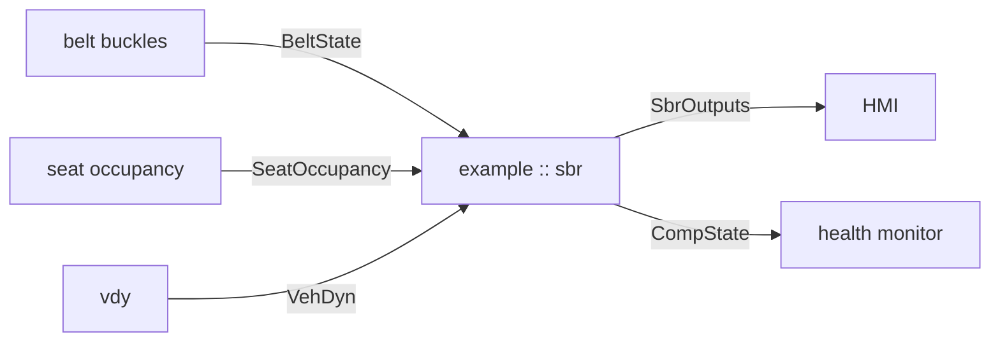

# SBR — architecture

**A supporting document** (`R-REQ-17`, declared under `context:` in
`layers.yaml`). Same contract as `SBR_Concept.md`: no UIDs, no obligations, no
execution narration. It says *how it is built*; the concept says *why*.

## 1. Where SBR sits

## 2. Ports

| Direction | Port | Type | Why |
|---|---|---|---|
| in | `beltState` | `adas.common.BeltState` | the buckle signal, per seat |
| in | `occupancy` | `adas.common.SeatOccupancy` | so an empty seat is silent |
| in | `egoDyn` | `adas.common.VehDyn` | the speed gate, concept §4 |
| out | `sbr.outputs` | `adas.example.SbrOutputs` | per-seat reminder state and stage |
| out | `sbr.compState` | `adas.example.CompState` | mandatory heartbeat; lifecycle, not availability |

Both inputs are debounced before they are combined, and that is why `belt` and
`occ` are two software items rather than one: they debounce on different time
constants — a buckle is a clean switch, an occupancy mat is not.

## 3. Decomposition

| File | Item | Holds |
|---|---|---|
| `sbr_function.cpp` | — | `exec(dtS)` and the order below |
| `sbr_belt.cpp` | `belt` | buckle debounce |
| `sbr_occupancy.cpp` | `occ` | occupancy debounce |
| `sbr_gates.cpp` | `gate` | speed and availability gating |
| `sbr_escalation.cpp` | `esc` | the stage timer |
| `sbr_state.cpp` | `state` | latch and clear |
| `sbr_params.cpp` | `calib` | calibration read from the config bundle |

The order is fixed: debounce both inputs, gate, decide, escalate, latch. Gating
runs **before** escalation so a vehicle slowing to a stop cannot advance a
stage on its way down.
