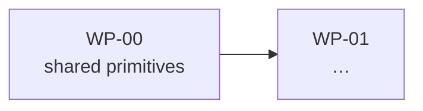

# <MODULE> — Implementation Design

<!--
TEMPLATE. Two documents share this shape and the difference is one line in
layers.yaml. Pick one before you start:

  A. THE GOVERNED `IMP` LAYER -- declared in `layers.yaml` under `layers:` with
     `row_style: table`, allocating `IMP-nnnn` UIDs, one row per software
     requirement. Instantiate as <MODULE>_Implementation_Design.md and declare
     it under `plan:` as well if the build order lives in the same file.
     Columns:  | Box | UID | Serves | WP | Change | Artifact - Design | Tests |

  B. A DELIVERY DESIGN -- one document per surface the function is built into
     (the viewer, the simulator, CarMaker, CARLA). Declared under `context:`
     with `kind: architecture` and `rollup: true`. It allocates NO UID: its row
     ids and package series are scoped to itself (VZ-/SM-/CM-/CA-,
     WP-V/WP-S/WP-C/WP-K), because the work is real but it is not a feature
     obligation -- C-CONTEXT-UID enforces that.
     Columns:  | Box | ID | WP | Change | Artifact - design |

WHY BOTH ARE HERE RATHER THAN IN TWO FILES: they are the same document with a
different id namespace, and two templates would be two things to hold in
agreement. Delete the half you are not using, then delete this comment block.

ONE DOCUMENT OR TWO. The build order (the package list) and the design rows may
live in one file or two. One file below a few dozen rows -- keeping them apart
would mean two files to hold in agreement for no reader's benefit. Two when the
row count genuinely needs its own file (modules/sim/docs/v2 splits at 379). It
is a scale decision, not a principle; `layers.yaml` says which by whether
`plan:` names this file or another.

THE TEST IS TENSE (R-REQ-14). A design row says what WILL be true of the code --
a promise a reviewer can hold the diff against. What was run, what was found and
how long it took is execution narration: it belongs in a Test Execution Record,
a commit message or `git log`, never here. A row in the past tense is in the
wrong document.

LENGTH IS EXPECTED AND IS NOT CAPPED. An IMP row's job is to name which file,
which symbol, in what order, so this document is dense by design and exempt from
commentary_lines_per_requirement.
-->

**One document, not two.** The build order is on top; the design rows are below.
At <n> rows one file is short enough that keeping the order and the detail apart
would mean two files to hold in agreement for no reader's benefit.

**Package numbers are ids, not positions.** The order is the order of the list
below.

**A package row says only what it alone knows** — the box, the headline, and why
it sits where it does in the order. **What it lands is not written there**: that
is the `WP` column of the table, one place, beside the artifact it describes, so
a package and a row cannot disagree. `--status` derives the contents.

**A path below is a promise** — the code goes at that path under that name. A
row claiming `KEEP` for code that does not exist is a design error visible
without opening a file.

## Progress (`R-REQ-6a`)

**The design rows' boxes are the only hand-maintained progress state in this
set.** **The row is the atom, not the package**: a design row is one buildable
artifact — one file, one symbol — whereas a package is a bag of them, so a
package-level box can only ever say *some of this happened*. The `Box` column of
the table below is what a person types; **a package's own box is recomputed from
the rows it lands** and the checker fails on disagreement.

| Box | Means |
|---|---|
| `[ ]` | not started |
| `[~]` | started — **and the row must say `closed by <command or condition>`** |
| `[x]` | done — the tests the requirements name pass |

| Rows it lands | Package box |
|---|---|
| all `[x]` | `[x]` |
| all `[ ]` | `[ ]` |
| anything between | `[~]` |

| Check | Fires on |
|---|---|
| `C-ROWBOX` | a design row with no box |
| `C-ROWMARK` | a row `[~]` that does not say `closed by <what>` |
| `C-WPROLL` | a package box disagreeing with its rows' rollup |
| `C-PLANMARK` | a package `[~]` with no resume condition |

**The box is the first column, always** — one rule, so a reader never counts
cells to find the state. **Progress is not verification** (`R-REQ-6`): a ticked
box says the work was done; whether the requirement is *met* is a Test Execution
Record's answer, one per campaign.

---

## Blocked, and by what

<!-- Delete if nothing is blocked. Name the open question and its owner; do not
     invent an answer to unblock a row on paper. -->

**`WP-nn` is blocked on `<Q>`** — <what is undecided, and whose decision it is>.
Nothing else in the order depends on it.

## Order, and why

<!-- Prose, one short paragraph: what has to exist before what, and the reason.
     Then the list, then the same thing as a DAG so the reader can check the
     prose against a picture. -->

<Shared primitives first, because … Then interface and calibration, because …>

- [ ] **WP-00** — <headline> · <why it sits here>
- [ ] **WP-01** — <headline> · <why it sits here>

---

## Design rows

<!-- FORM A, the governed IMP layer. One row per software requirement.
     `Change` is a closed vocabulary checked by C-CHANGE, and it is DERIVED FROM
     WHAT EXISTS TODAY, never asserted:

       KEEP    code exists at the right path; its body is not touched
       MOVE    code exists and is reusable; the file moves
       DEDUPE  two implementations; one survives, one is deleted
       EXTEND  code exists and is narrower; logic is added, not rewritten
       NEW     nothing exists
       DROP    the behaviour leaves the product

     `Tests` repeats the tests of the SW it serves, so a row is self-contained;
     this layer declares no test ids of its own (`tests: []` in layers.yaml) --
     giving it separate ones would create a second, weaker copy of the same
     checks. -->

| Box | UID | Serves | WP | Change | Artifact — Design | Tests |
|---|---|---|---|---|---|---|
| `[ ]` | `IMP-0001` | `SW-0001` | `WP-00` | `NEW` | `path/file.hpp::symbol(args)` — what it does, and the one property that makes this the right shape. | `UT-<item>-01` |

<!-- FORM B, a delivery design. Same discipline, ids scoped to this document,
     no `Serves` column because it serves no requirement: it builds a surface.

| Box | ID | WP | Change | Artifact — design |
|---|---|---|---|---|
| `[ ]` | `VZ-01` | `WP-V01` | `NEW` | `path/file.py::symbol` — what it does. |

     Turned on by `rollup: true` beside this document's `context:` entry in
     layers.yaml. `--status` then reports it beside the function's own build
     order, so a delivery surface can never be the half of the work nobody is
     counting. Declaring `rollup: true` on a document with no boxed row is
     C-ROLLUP-EMPTY -- a rollup that rolls nothing up reads as coverage. -->
