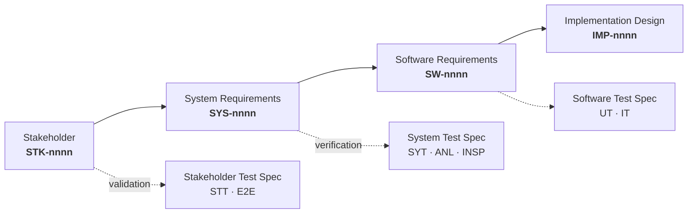

# <MODULE> — <Module one-line description>
## <Layer> Requirements Specification — v<n>

**Owner:** <team>
**Derived from:** `<parent document>` — the layer above. *(Concept layer: state the evidence base instead.)*
**Status:** Draft for review. Not baselined. No requirement here is authoritative until §9's open decisions are closed.
**Audience:** <who implements this, and who writes the documents derived from it>

> **The master is `<MODULE>_Concept_Document_v<n>.md`.** Where anything here appears to disagree with it, the concept wins and this document is wrong.

---

## 0. How to read this document

### 0.1 Where this document sits



**Substitute this table's row for your layer, then delete the table.**

| Layer | UID | Observer — *who could see this be false?* | Verified by | Emphasis |
|---|---|---|---|---|
| Stakeholder | `STK-nnnn` | The stakeholder, using or buying the product | `STT-nn` · `E2E-nn` | What was asked for, and why |
| System | `SYS-nnnn` | Anyone at the external boundary, no source access | `SYT-<area>-nn` · `ANL-nn` · `INSP-nn` | Observable behaviour at the boundary |
| Software | `SW-nnnn` | A developer holding one item, collaborators stubbed | `UT-<item>-nn` · `IT-nn` | What each item must do internally |
| Impl/Design | `IMP-nnnn` | A reviewer holding the file | `ANL-*` · build gates | Which file, which symbol, which signature |

### 0.2 Two numbers, on purpose

| What | Example | Rule |
|---|---|---|
| **Heading number** | `7.3` | Position in the document. Changes when sections move. Use it when talking to people. |
| **UID** | `<PREFIX>-0042` | Stable identity. Allocated once, in creation order, **never changed and never reused.** Use it in trace links. |

New requirements append at the end of their section. A retired requirement moves
to §8, never deleted silently and never reused (`R-REQ-2`).

### 0.3 Anatomy of a requirement

```
**`<PREFIX>-nnnn`** · `P0` · `R1` — Headline
**Shall.** The single normative statement. Exactly one "shall" per requirement.
**Accept.** The observable condition that decides pass or fail. Written so it can be false.
**Verify.** <method> · `<test id>`   **Trace.** <parent UID>[, …]
```

| Field | Rule |
|---|---|
| **Shall** | One obligation. If it needs "and" twice, it is two requirements — a test cannot half-pass. |
| **Accept** | **Falsifiable.** If no observation could contradict it, it is a motivation: demote it to prose, or replace it with the checklist it is really asking for. Must *measure*, not restate the `Shall`. |
| **Verify** | Method + the identifier of the test that implements it. The identifier is written into the test itself, so the link is found by `grep` (`R-REQ-9`). |
| **Trace** | ≥1 parent UID — or `—` if this is the **top declared layer** in `layers.yaml`, where unparented is correct by definition (`R-REQ-12`). Below that, empty means this was written at the wrong layer, or the layer above is incomplete. |
| **Category** | *(layers declaring `categories:`, i.e. `STK`)* `feature` or `kpi`, from the module's declared list (`R-REQ-16`). A `kpi` row's `Accept` must state a number or `⊘` — the checker rejects one that states neither. |

**There is deliberately no status field** (`R-REQ-6`). Verification status is
derived from the execution record, never stored by hand in a second place.

### 0.4 Verification methods

| Code | Method | Means |
|---|---|---|
| **T** | Test | Automated execution asserting an outcome. Default; preferred always. |
| **D** | Demonstration | Executed, observed, recorded — for human-visible behaviour. Scripted and evidence-attached, never "we tried it". |
| **A** | Analysis | A derived measurement or static check over the codebase or artifacts. Ships a planted-violation case (`R-REQ-9`). |
| **I** | Inspection | Review against a **named** checklist. Only where no execution is possible, so "inspected" can never mean "someone read it". |

### 0.5 Test identifier scheme

Reserved here so every `Verify` link resolves and the test specification has a
fixed namespace.

| Prefix | Level | Scope |
|---|---|---|
| `<...>` | | |

Area/item tokens, declared once: `<TOK>` … — never invented at the point of use.

### 0.6 Priority

| Code | Meaning |
|---|---|
| `P0` | Unusable without it. |
| `P1` | A stated goal degrades without it. **Default when unmarked.** |
| `P2` | Valuable, deferrable. |

**Assign priority comparatively, never on a requirement's own merits.** Rated
individually almost everything looks essential, and the field stops carrying
information at the exact moment it is needed — when time runs short and
something must give. Forcing question: *if this were missing on release day,
would it be unusable, or merely worse?* Record the resulting distribution here;
a set that is majority `P0` has not been triaged.

### 0.7 Release scope

| Code | Meaning |
|---|---|
| `R1` | First release. |
| `R2` | Second release. |
| `DEF` | Deferred. **Carries its reason inline.** |

---

## 1. Purpose and scope

### 1.1 The <system / item>

<What this is, in a paragraph a newcomer can hold.>

### 1.2 Scope boundary

| Inside | Outside |
|---|---|
| | |

<State the boundary most likely to be violated, and why it is load-bearing.>

---

## 2. Evidence base

<Sources this was written against. Where two disagreed, record the disagreement
rather than smoothing it — a smoothed disagreement reappears as a defect.>

| Source | Used for |
|---|---|

---

## 3. Interfaces

<Name every interface this layer's requirements refer to, with an `IF-nn`
identifier. This section is the Interface Specification's table of contents;
it is not the specification itself.>

| ID | Interface | Between | Specified in |
|---|---|---|---|

---

# PART A — FUNCTIONAL REQUIREMENTS

## 4. <Area>

**`<PREFIX>-0001`** · `P0` · `R1` — <headline>
**Shall.** <one obligation>
**Accept.** <falsifiable observation>
**Verify.** T · `<test-id>`   **Trace.** <parent UID>

**`<PREFIX>-0002`** · `P1` · `R1` — <headline>
**Shall.**
**Accept.**
**Verify.**    **Trace.**

---

# PART B — NON-FUNCTIONAL REQUIREMENTS

## 5. <Quality attribute>

<Same anatomy. A non-functional requirement is held to the falsifiability rule
harder, not softer — "shall be fast" is the canonical unfalsifiable
requirement. Give the number, the fixture and the measurement conditions, or
mark the threshold `⊘` and name the open question (`R-REQ-10`).>

---

# PART C — CONSTRAINTS

## 6. <Constraint area>

<Imposed rather than chosen. State the imposer.>

---

## 7. Verification strategy

<How this layer's requirements are collectively verified, and what the test
specification must therefore contain. Coverage is bidirectional: every
requirement has ≥1 test, every test serves ≥1 requirement.>

| Method | Count | Notes |
|---|---|---|

---

## 8. Superseded and retired UIDs

Never delete a UID. A reader following a dead trace link must land on an
explanation, not on nothing.

| UID | Retired | Replaced by | Why |
|---|---|---|---|

---

## 9. Open decisions

Blocking. No requirement above is authoritative until these close. Each carries
who decides — a decision recorded without an owner is a decision nobody makes.

| # | Question | Blocks | Decided by |
|---|---|---|---|
